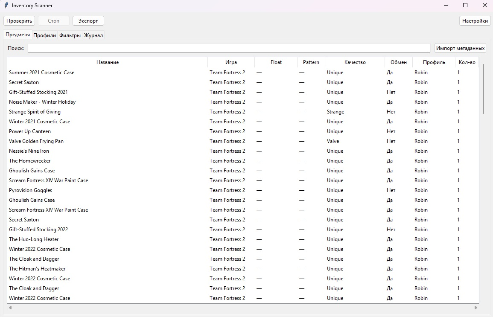
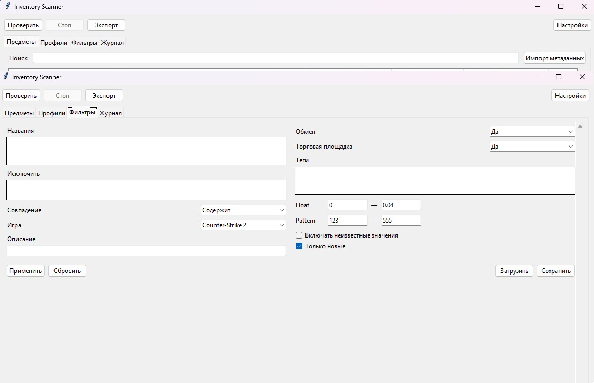
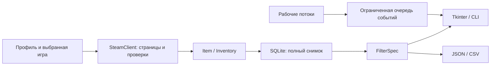

# Inventory Scanner

**Приложение на Python для просмотра публичных Steam-инвентарей с графическим интерфейсом и настраиваемыми фильтрами.**

[](https://github.com/gorniy11/Inventory-Scanner/actions/workflows/checks.yml)





**Inventory Scanner** — приложение для просмотра и фильтрации публичных Steam-инвентарей. По умолчанию открывается сохранённый снимок **реального публичного инвентаря Robin Walker, разработчика Valve**. Для просмотра примера вход в Steam и сетевые запросы не нужны. Источник, дата получения и состав снимка приведены в [описании примера](docs/PUBLIC_SAMPLE.md).

## Ознакомительный режим

Приложение намеренно ограничено одной сессией:

- до **3 уникальных профилей** и до **12 инвентарей**;
- каждый выбранный инвентарь проверяется **один раз**, включая неудачные попытки;
- не больше **50 HTTP-запросов** за сессию, включая страницы инвентаря и разрешение ссылок;
- через **15 минут после запуска** новые сетевые запросы блокируются;
- не больше двух рабочих потоков; общий интервал запросов — две секунды;
- постоянного мониторинга, расписаний, автоматических повторов и фонового автозапуска нет.

Результаты после исчерпания лимита остаются доступны для изучения, фильтрации и экспорта. Ограничения действуют в приложении; открытый исходный код доступен по лицензии MIT.

## Что можно попробовать

- Добавить SteamID64, ссылку `/profiles/…` или пользовательскую ссылку `/id/…`.
- Выбрать CS2, Dota 2, Rust и TF2 независимо друг от друга.
- Сопоставить названия целиком или по подстроке, задать исключения и текст в описании.
- Отобрать предметы по доступности для обмена и Торговой площадки, качеству, редкости, типу или любому другому тегу Steam.
- Задать диапазон float и pattern seed CS2 с явным правилом для неизвестных значений.
- Сохранить фильтр в JSON, загрузить готовый пример, экспортировать все совпадения в JSON или CSV.
- Выделить несколько строк, скопировать названия, посмотреть подробности или открыть точную страницу предмета в инвентаре.
- Посмотреть журнал проверки.


## Запуск

Нужен **Python 3.11+** с Tkinter. На Windows Tkinter входит в обычный установщик Python; на Debian/Ubuntu при необходимости установите пакет `python3-tk`.

```console
python -m venv .venv
```

Активируйте окружение:

```powershell
# Windows PowerShell
.venv\Scripts\Activate.ps1
```

```bash
# Linux / macOS
source .venv/bin/activate
```

```console
python -m pip install -e .
inventory-scanner
```

Также работает `python -m inventory_scanner`. Режим сохранённого примера не обращается к сети. Для **одного ознакомительного прохода по своим публичным инвентарям** запустите:

```console
inventory-scanner --live
```

Во вкладке «Профили» добавьте собственную ссылку, выберите игры и нажмите «Проверить». Вход в аккаунт и ключ Steam API не требуются. Закрытые инвентари недоступны.

По умолчанию используется временная SQLite-база, удаляемая при закрытии. Для сохранения локальных результатов можно передать `--data-dir data`. Разные режимы используют разные базы. Файлы данных исключены из Git.

### Командная строка

```console
inventory-scanner scan "https://steamcommunity.com/id/ВАШ_ПРОФИЛЬ/" --live --games cs2 dota2 --output exports/items.json
inventory-scanner scan ВАШ_STEAMID64 --live --games cs2 --filter examples/cs2-low-float.json --output exports/items.csv
```

CLI также выполняет один проход и соблюдает лимит запросов. При ошибке полный успешный экспорт не подменяется частичной выдачей.

## Фильтры

Условия разных полей объединяются через **И**. Названия внутри списка включения — через **ИЛИ**. Исключения — буквальные подстроки, без регулярных выражений. Сопоставление не зависит от регистра. Теги приходят из английской выдачи Steam, поэтому их значения вводятся на английском:

```text
Rarity=Immortal
Type=Wearable
```

Оба условия должны выполняться у одного предмета. Доступные теги конкретного предмета видны в его подробностях; состав категорий зависит от игры. Примеры конфигураций находятся в [examples](examples).

### Откуда берётся float

Обычная выдача инвентаря не гарантирует точный float. Программа **не вычисляет его из названия износа**.

1. Если CS2 inspect-ссылка содержит самодостаточный payload, он декодируется локально. Поддерживаются обычная и XOR-маскированная формы. Для обычной формы проверяется контрольная сумма; для маскированной — структура и обязательные поля. При наличии item ID он сверяется с asset ID.
2. Старые ссылки `S…A…D…` и `M…A…D…` остаются без точного float. Для них можно импортировать собственный JSON с метаданными через кнопку в таблице.
3. Импорт привязан к тройке `owner_id + app_id + asset_id`. Шаблон: [cs2-metadata.template.json](examples/cs2-metadata.template.json). Заполните идентификаторы и известные значения перед импортом.

Знак **«—» означает неизвестное значение**, а не ноль. По умолчанию диапазон float/seed исключает неизвестные значения; отдельная галочка меняет это поведение. Для Dota 2, Rust и TF2 применяйте общие названия, теги и описания.

Описание формата и контрольные векторы сверены с [CSFloat Inspect Serializer](https://github.com/csfloat/cs-inspect-serializer). Атрибуция: [THIRD_PARTY_NOTICES.md](THIRD_PARTY_NOTICES.md).

## Архитектура



- `steam.py` — публичная выдача Steam Community, пагинация, общий лимит запросов и обработка `Retry-After`.
- `models.py`, `profiles.py`, `filters.py` — модели, проверка ссылок и чистые правила отбора.
- `inspect.py` — локальное чтение CS2-метаданных без отдельного сервиса.
- `storage.py` — транзакционная замена снимка, история первого появления и импорт метаданных.
- `scanner.py` — ограниченный разовый проход в двух потоках; повторные задания не создаются.
- `gui.py` — русский интерфейс; сетевые операции и выборка результатов выполняются вне потока Tk.

Ошибки, отсутствующие описания, повторы asset ID, изменившийся общий размер и оборванная пагинация не становятся «успешным» снимком. Таблица показывает до 2000 строк, при этом экспорт охватывает все совпадения. Очередь интерфейса и журнал ограничены по размеру.

Используется публичный endpoint Steam Community `/inventory/{steamid}/{appid}/2/`. Он не является гарантированным контрактом Steamworks и может менять формат или ограничивать запросы. Это не publisher-only метод `IInventoryService/GetInventory`. Проект только читает данные и соблюдает ограничения доступа.

## Проверки

```console
python -m pip install -e ".[dev]"
ruff check src tests tools
python -m unittest discover -s tests -v
python tools/check_gui.py
```


## Лицензия

[MIT](LICENSE). Названия игр и Steam принадлежат соответствующим правообладателям. Проект независим от Valve и разработчиков игр.
