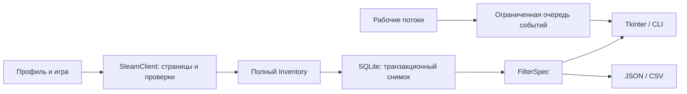

# Архитектура

| Модуль в src/inventory_scanner | Ответственность |
|---|---|
| profiles.py | Разбор и проверка ссылок профилей |
| steam.py | Запросы, общий лимит, пагинация и проверка полноты |
| models.py | Модели игры, предмета и инвентаря |
| filters.py | Независимые от интерфейса правила отбора |
| inspect.py | Локальное чтение поддерживаемых CS2-метаданных |
| storage.py | SQLite, сохранение полного снимка, история и импорт метаданных |
| scanner.py | Разовый проход в двух потоках, отмена, события |
| gui.py | Русский интерфейс и отображение результатов |
| exporting.py | CSV/JSON без ограничения числа видимых строк |

## Почему снимок заменяется целиком

Нельзя считать страницу инвентаря полным результатом. Клиент читает все страницы, проверяет уникальность и количество, затем хранилище заменяет снимок транзакционно. При ошибке предыдущий полный снимок остаётся доступен.

Сетевые операции и выборки выполняются вне потока Tk. События передаются через ограниченную очередь; повторные запросы перерисовки объединяются. В таблице показывается до 2000 строк, журнал ограничен.

[[Тестирование]] · [[Home]]
